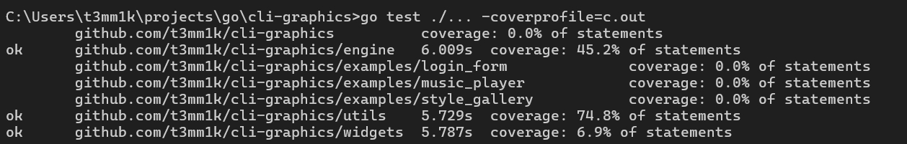

```
?       github.com/t3mm1k/cli-graphics  [no test files]
=== RUN   TestBuffer_Clear
=== RUN   TestBuffer_Clear/TestBuffer_Clear
--- PASS: TestBuffer_Clear (0.00s)
    --- PASS: TestBuffer_Clear/TestBuffer_Clear (0.00s)
=== RUN   TestBuffer_SetSize
=== RUN   TestBuffer_SetSize/IncreaseSize
=== RUN   TestBuffer_SetSize/DecreaseSize
=== RUN   TestBuffer_SetSize/Panic_on_invalid_dimensions
--- PASS: TestBuffer_SetSize (0.00s)
    --- PASS: TestBuffer_SetSize/IncreaseSize (0.00s)
    --- PASS: TestBuffer_SetSize/DecreaseSize (0.00s)
    --- PASS: TestBuffer_SetSize/Panic_on_invalid_dimensions (0.00s)
=== RUN   TestNewBuffer
=== RUN   TestNewBuffer/ValidSize
=== RUN   TestNewBuffer/ZeroWidth
=== RUN   TestNewBuffer/NegativeHeight
=== RUN   TestNewBuffer/ZeroSize
--- PASS: TestNewBuffer (0.00s)
    --- PASS: TestNewBuffer/ValidSize (0.00s)
    --- PASS: TestNewBuffer/ZeroWidth (0.00s)
    --- PASS: TestNewBuffer/NegativeHeight (0.00s)
    --- PASS: TestNewBuffer/ZeroSize (0.00s)
=== RUN   TestCanvas_SetCell
=== RUN   TestCanvas_SetCell/inside_bounds
=== RUN   TestCanvas_SetCell/top-left_corner
=== RUN   TestCanvas_SetCell/bottom-right_corner
=== RUN   TestCanvas_SetCell/negative_X
=== RUN   TestCanvas_SetCell/negative_Y
=== RUN   TestCanvas_SetCell/out_of_bounds_X
=== RUN   TestCanvas_SetCell/out_of_bounds_Y
--- PASS: TestCanvas_SetCell (0.00s)
    --- PASS: TestCanvas_SetCell/inside_bounds (0.00s)
    --- PASS: TestCanvas_SetCell/top-left_corner (0.00s)
    --- PASS: TestCanvas_SetCell/bottom-right_corner (0.00s)
    --- PASS: TestCanvas_SetCell/negative_X (0.00s)
    --- PASS: TestCanvas_SetCell/negative_Y (0.00s)
    --- PASS: TestCanvas_SetCell/out_of_bounds_X (0.00s)
    --- PASS: TestCanvas_SetCell/out_of_bounds_Y (0.00s)
=== RUN   TestCanvas_SubCanvas
=== RUN   TestCanvas_SubCanvas/child_fully_inside_parent
=== RUN   TestCanvas_SubCanvas/child_exceeds_parent_right_edge
=== RUN   TestCanvas_SubCanvas/child_drawing_beyond_clipped_edge
=== RUN   TestCanvas_SubCanvas/child_outside_parent_completely
--- PASS: TestCanvas_SubCanvas (0.00s)
    --- PASS: TestCanvas_SubCanvas/child_fully_inside_parent (0.00s)
    --- PASS: TestCanvas_SubCanvas/child_exceeds_parent_right_edge (0.00s)
    --- PASS: TestCanvas_SubCanvas/child_drawing_beyond_clipped_edge (0.00s)
    --- PASS: TestCanvas_SubCanvas/child_outside_parent_completely (0.00s)
=== RUN   TestCanvas_SetRune
=== RUN   TestCanvas_SetRune/set_custom_rune
--- PASS: TestCanvas_SetRune (0.00s)
    --- PASS: TestCanvas_SetRune/set_custom_rune (0.00s)
=== RUN   TestCanvas_DrawString
=== RUN   TestCanvas_DrawString/renders_string_horizontally
=== RUN   TestCanvas_DrawString/clips_string_at_canvas_boundary
--- PASS: TestCanvas_DrawString (0.00s)
    --- PASS: TestCanvas_DrawString/renders_string_horizontally (0.00s)
    --- PASS: TestCanvas_DrawString/clips_string_at_canvas_boundary (0.00s)
=== RUN   TestCanvas_DrawRect
=== RUN   TestCanvas_DrawRect/ignores_dimensions_smaller_than_2
=== RUN   TestCanvas_DrawRect/draws_single_border_correctly
=== RUN   TestCanvas_DrawRect/draws_rounded_border
=== RUN   TestCanvas_DrawRect/draws_double_border
--- PASS: TestCanvas_DrawRect (0.00s)
    --- PASS: TestCanvas_DrawRect/ignores_dimensions_smaller_than_2 (0.00s)
    --- PASS: TestCanvas_DrawRect/draws_single_border_correctly (0.00s)
    --- PASS: TestCanvas_DrawRect/draws_rounded_border (0.00s)
    --- PASS: TestCanvas_DrawRect/draws_double_border (0.00s)
=== RUN   TestFocusManager_Empty
--- PASS: TestFocusManager_Empty (0.00s)
=== RUN   TestFocusManager_Cycle
--- PASS: TestFocusManager_Cycle (0.00s)
=== RUN   TestFocusManager_SetFocused
--- PASS: TestFocusManager_SetFocused (0.00s)
=== RUN   TestBorderType_String
=== RUN   TestBorderType_String/borderType_to_string:_none
=== RUN   TestBorderType_String/borderType_to_string:_single
=== RUN   TestBorderType_String/borderType_to_string:_double
=== RUN   TestBorderType_String/borderType_to_string:_rounded
=== RUN   TestBorderType_String/borderType_to_string:_bold
--- PASS: TestBorderType_String (0.00s)
    --- PASS: TestBorderType_String/borderType_to_string:_none (0.00s)
    --- PASS: TestBorderType_String/borderType_to_string:_single (0.00s)
    --- PASS: TestBorderType_String/borderType_to_string:_double (0.00s)
    --- PASS: TestBorderType_String/borderType_to_string:_rounded (0.00s)
    --- PASS: TestBorderType_String/borderType_to_string:_bold (0.00s)
=== RUN   TestDefaultStyle
=== RUN   TestDefaultStyle/defaultStyle
--- PASS: TestDefaultStyle (0.00s)
    --- PASS: TestDefaultStyle/defaultStyle (0.00s)
=== RUN   TestParseColor
=== RUN   TestParseColor/ParseColor_from_baseColors
=== RUN   TestParseColor/ParseColor_from_HEX
=== RUN   TestParseColor/ParseColor_default
=== RUN   TestParseColor/ParseColor_invalid_value
--- PASS: TestParseColor (0.00s)
    --- PASS: TestParseColor/ParseColor_from_baseColors (0.00s)
    --- PASS: TestParseColor/ParseColor_from_HEX (0.00s)
    --- PASS: TestParseColor/ParseColor_default (0.00s)
    --- PASS: TestParseColor/ParseColor_invalid_value (0.00s)
=== RUN   TestParseStyles
=== RUN   TestParseStyles/empty_classes_returns_base_for_all_states
=== RUN   TestParseStyles/basic_classes_applied_and_inherited_by_all_states
=== RUN   TestParseStyles/state_overrides:_focus,_disabled,_active,_selected,_hover
--- PASS: TestParseStyles (0.00s)
    --- PASS: TestParseStyles/empty_classes_returns_base_for_all_states (0.00s)
    --- PASS: TestParseStyles/basic_classes_applied_and_inherited_by_all_states (0.00s)
    --- PASS: TestParseStyles/state_overrides:_focus,_disabled,_active,_selected,_hover (0.00s)
=== RUN   TestTextAlign_String
=== RUN   TestTextAlign_String/textAlign_to_string:_left
=== RUN   TestTextAlign_String/textAlign_to_string:_right
=== RUN   TestTextAlign_String/textAlign_to_string:_center
--- PASS: TestTextAlign_String (0.00s)
    --- PASS: TestTextAlign_String/textAlign_to_string:_left (0.00s)
    --- PASS: TestTextAlign_String/textAlign_to_string:_right (0.00s)
    --- PASS: TestTextAlign_String/textAlign_to_string:_center (0.00s)
=== RUN   TestTextOverflow_String
=== RUN   TestTextOverflow_String/textOverflow_to_string:_clip
=== RUN   TestTextOverflow_String/textOverflow_to_string:_truncate
--- PASS: TestTextOverflow_String (0.00s)
    --- PASS: TestTextOverflow_String/textOverflow_to_string:_clip (0.00s)
    --- PASS: TestTextOverflow_String/textOverflow_to_string:_truncate (0.00s)
=== RUN   TestTextStyle_String
=== RUN   TestTextStyle_String/textStyle_to_string:_bold
=== RUN   TestTextStyle_String/textStyle_to_string:_italic
=== RUN   TestTextStyle_String/textStyle_to_string:_underline
=== RUN   TestTextStyle_String/textStyle_to_string:_blink
=== RUN   TestTextStyle_String/textStyle_to_string:_dim
=== RUN   TestTextStyle_String/textStyle_to_string:_reverse
=== RUN   TestTextStyle_String/textStyle_to_string:_hidden
=== RUN   TestTextStyle_String/textStyle_to_string:_strikethrough
--- PASS: TestTextStyle_String (0.00s)
    --- PASS: TestTextStyle_String/textStyle_to_string:_bold (0.00s)
    --- PASS: TestTextStyle_String/textStyle_to_string:_italic (0.00s)
    --- PASS: TestTextStyle_String/textStyle_to_string:_underline (0.00s)
    --- PASS: TestTextStyle_String/textStyle_to_string:_blink (0.00s)
    --- PASS: TestTextStyle_String/textStyle_to_string:_dim (0.00s)
    --- PASS: TestTextStyle_String/textStyle_to_string:_reverse (0.00s)
    --- PASS: TestTextStyle_String/textStyle_to_string:_hidden (0.00s)
    --- PASS: TestTextStyle_String/textStyle_to_string:_strikethrough (0.00s)
=== RUN   Test_applyRule
=== RUN   Test_applyRule/border_type_rule
=== RUN   Test_applyRule/align_rule
=== RUN   Test_applyRule/overflow_rule
=== RUN   Test_applyRule/textstyle_rule
=== RUN   Test_applyRule/padding_rule
=== RUN   Test_applyRule/fg_color_rule
=== RUN   Test_applyRule/bg_color_rule
=== RUN   Test_applyRule/border_fg_rule
=== RUN   Test_applyRule/border_bg_rule
--- PASS: Test_applyRule (0.00s)
    --- PASS: Test_applyRule/border_type_rule (0.00s)
    --- PASS: Test_applyRule/align_rule (0.00s)
    --- PASS: Test_applyRule/overflow_rule (0.00s)
    --- PASS: Test_applyRule/textstyle_rule (0.00s)
    --- PASS: Test_applyRule/padding_rule (0.00s)
    --- PASS: Test_applyRule/fg_color_rule (0.00s)
    --- PASS: Test_applyRule/bg_color_rule (0.00s)
    --- PASS: Test_applyRule/border_fg_rule (0.00s)
    --- PASS: Test_applyRule/border_bg_rule (0.00s)
=== RUN   Test_parseColorRule
=== RUN   Test_parseColorRule/fg:yellow
=== RUN   Test_parseColorRule/bg:black
=== RUN   Test_parseColorRule/border:red
=== RUN   Test_parseColorRule/border-bg:white
=== RUN   Test_parseColorRule/hex_fg
=== RUN   Test_parseColorRule/invalid_color
=== RUN   Test_parseColorRule/invalid_prefix
--- PASS: Test_parseColorRule (0.00s)
    --- PASS: Test_parseColorRule/fg:yellow (0.00s)
    --- PASS: Test_parseColorRule/bg:black (0.00s)
    --- PASS: Test_parseColorRule/border:red (0.00s)
    --- PASS: Test_parseColorRule/border-bg:white (0.00s)
    --- PASS: Test_parseColorRule/hex_fg (0.00s)
    --- PASS: Test_parseColorRule/invalid_color (0.00s)
    --- PASS: Test_parseColorRule/invalid_prefix (0.00s)
=== RUN   Test_parsePadding
=== RUN   Test_parsePadding/p-2
=== RUN   Test_parsePadding/px-3
=== RUN   Test_parsePadding/py-4
=== RUN   Test_parsePadding/pt-1
=== RUN   Test_parsePadding/pb-5
=== RUN   Test_parsePadding/pl-6
=== RUN   Test_parsePadding/pr-7
=== RUN   Test_parsePadding/invalid_format
=== RUN   Test_parsePadding/unknown_prefix
--- PASS: Test_parsePadding (0.00s)
    --- PASS: Test_parsePadding/p-2 (0.00s)
    --- PASS: Test_parsePadding/px-3 (0.00s)
    --- PASS: Test_parsePadding/py-4 (0.00s)
    --- PASS: Test_parsePadding/pt-1 (0.00s)
    --- PASS: Test_parsePadding/pb-5 (0.00s)
    --- PASS: Test_parsePadding/pl-6 (0.00s)
    --- PASS: Test_parsePadding/pr-7 (0.00s)
    --- PASS: Test_parsePadding/invalid_format (0.00s)
    --- PASS: Test_parsePadding/unknown_prefix (0.00s)
=== RUN   Test_str2align
=== RUN   Test_str2align/left
=== RUN   Test_str2align/center
=== RUN   Test_str2align/right
=== RUN   Test_str2align/invalid
--- PASS: Test_str2align (0.00s)
    --- PASS: Test_str2align/left (0.00s)
    --- PASS: Test_str2align/center (0.00s)
    --- PASS: Test_str2align/right (0.00s)
    --- PASS: Test_str2align/invalid (0.00s)
=== RUN   Test_str2bordertype
=== RUN   Test_str2bordertype/single
=== RUN   Test_str2bordertype/rounded
=== RUN   Test_str2bordertype/double
=== RUN   Test_str2bordertype/bold
=== RUN   Test_str2bordertype/none
=== RUN   Test_str2bordertype/invalid
--- PASS: Test_str2bordertype (0.00s)
    --- PASS: Test_str2bordertype/single (0.00s)
    --- PASS: Test_str2bordertype/rounded (0.00s)
    --- PASS: Test_str2bordertype/double (0.00s)
    --- PASS: Test_str2bordertype/bold (0.00s)
    --- PASS: Test_str2bordertype/none (0.00s)
    --- PASS: Test_str2bordertype/invalid (0.00s)
=== RUN   Test_str2overflow
=== RUN   Test_str2overflow/truncate
=== RUN   Test_str2overflow/clip
=== RUN   Test_str2overflow/invalid
--- PASS: Test_str2overflow (0.00s)
    --- PASS: Test_str2overflow/truncate (0.00s)
    --- PASS: Test_str2overflow/clip (0.00s)
    --- PASS: Test_str2overflow/invalid (0.00s)
=== RUN   Test_str2textstyle
=== RUN   Test_str2textstyle/bold
=== RUN   Test_str2textstyle/dim
=== RUN   Test_str2textstyle/italic
=== RUN   Test_str2textstyle/underline
=== RUN   Test_str2textstyle/blink
=== RUN   Test_str2textstyle/reverse
=== RUN   Test_str2textstyle/hidden
=== RUN   Test_str2textstyle/strikethrough
=== RUN   Test_str2textstyle/invalid
--- PASS: Test_str2textstyle (0.00s)
    --- PASS: Test_str2textstyle/bold (0.00s)
    --- PASS: Test_str2textstyle/dim (0.00s)
    --- PASS: Test_str2textstyle/italic (0.00s)
    --- PASS: Test_str2textstyle/underline (0.00s)
    --- PASS: Test_str2textstyle/blink (0.00s)
    --- PASS: Test_str2textstyle/reverse (0.00s)
    --- PASS: Test_str2textstyle/hidden (0.00s)
    --- PASS: Test_str2textstyle/strikethrough (0.00s)
    --- PASS: Test_str2textstyle/invalid (0.00s)
PASS
ok      github.com/t3mm1k/cli-graphics/engine   2.430s
?       github.com/t3mm1k/cli-graphics/examples/login_form      [no test files]
?       github.com/t3mm1k/cli-graphics/examples/music_player    [no test files]
?       github.com/t3mm1k/cli-graphics/examples/style_gallery   [no test files]
=== RUN   TestParseKey
=== RUN   TestParseKey/empty_bytes
=== RUN   TestParseKey/single_char_ASCII
=== RUN   TestParseKey/space
=== RUN   TestParseKey/tab
=== RUN   TestParseKey/enter_line_feed
=== RUN   TestParseKey/enter_carriage_return
=== RUN   TestParseKey/escape
=== RUN   TestParseKey/backspace_8
=== RUN   TestParseKey/backspace_127
=== RUN   TestParseKey/ctrl+c
=== RUN   TestParseKey/arrow_up
=== RUN   TestParseKey/arrow_down
=== RUN   TestParseKey/arrow_right
=== RUN   TestParseKey/arrow_left
=== RUN   TestParseKey/shift+tab
=== RUN   TestParseKey/home
=== RUN   TestParseKey/end
=== RUN   TestParseKey/insert_key
=== RUN   TestParseKey/delete_key
=== RUN   TestParseKey/page_up
=== RUN   TestParseKey/page_down
=== RUN   TestParseKey/utf8_russian_rune
--- PASS: TestParseKey (0.00s)
    --- PASS: TestParseKey/empty_bytes (0.00s)
    --- PASS: TestParseKey/single_char_ASCII (0.00s)
    --- PASS: TestParseKey/space (0.00s)
    --- PASS: TestParseKey/tab (0.00s)
    --- PASS: TestParseKey/enter_line_feed (0.00s)
    --- PASS: TestParseKey/enter_carriage_return (0.00s)
    --- PASS: TestParseKey/escape (0.00s)
    --- PASS: TestParseKey/backspace_8 (0.00s)
    --- PASS: TestParseKey/backspace_127 (0.00s)
    --- PASS: TestParseKey/ctrl+c (0.00s)
    --- PASS: TestParseKey/arrow_up (0.00s)
    --- PASS: TestParseKey/arrow_down (0.00s)
    --- PASS: TestParseKey/arrow_right (0.00s)
    --- PASS: TestParseKey/arrow_left (0.00s)
    --- PASS: TestParseKey/shift+tab (0.00s)
    --- PASS: TestParseKey/home (0.00s)
    --- PASS: TestParseKey/end (0.00s)
    --- PASS: TestParseKey/insert_key (0.00s)
    --- PASS: TestParseKey/delete_key (0.00s)
    --- PASS: TestParseKey/page_up (0.00s)
    --- PASS: TestParseKey/page_down (0.00s)
    --- PASS: TestParseKey/utf8_russian_rune (0.00s)
=== RUN   TestParseSGRMouse_Comprehensive
=== RUN   TestParseSGRMouse_Comprehensive/Positive:_Left_click_press_at_10,20_converts_to_9,19
=== RUN   TestParseSGRMouse_Comprehensive/Positive:_Left_click_release_at_10,20_converts_to_9,19
=== RUN   TestParseSGRMouse_Comprehensive/Positive:_Mouse_drag/move_with_left_button_pressed
=== RUN   TestParseSGRMouse_Comprehensive/Positive:_Mouse_wheel_scroll_up
=== RUN   TestParseSGRMouse_Comprehensive/Positive:_Mouse_wheel_scroll_down
=== RUN   TestParseSGRMouse_Comprehensive/Edge_case:_Empty_byte_slice_input
=== RUN   TestParseSGRMouse_Comprehensive/Negative:_Invalid_ANSI_SGR_sequence_prefix
=== RUN   TestParseSGRMouse_Comprehensive/Negative:_Missing_trailing_M/m_action_character
=== RUN   TestParseSGRMouse_Comprehensive/Negative:_Incomplete_coordinates_(missing_Y_axis)
=== RUN   TestParseSGRMouse_Comprehensive/Negative:_Non-numeric_characters_inside_coordinates
=== RUN   TestParseSGRMouse_Comprehensive/Edge_case:_Zero_coordinates_handled_safely_without_integer_underflow
--- PASS: TestParseSGRMouse_Comprehensive (0.00s)
    --- PASS: TestParseSGRMouse_Comprehensive/Positive:_Left_click_press_at_10,20_converts_to_9,19 (0.00s)
    --- PASS: TestParseSGRMouse_Comprehensive/Positive:_Left_click_release_at_10,20_converts_to_9,19 (0.00s)
    --- PASS: TestParseSGRMouse_Comprehensive/Positive:_Mouse_drag/move_with_left_button_pressed (0.00s)
    --- PASS: TestParseSGRMouse_Comprehensive/Positive:_Mouse_wheel_scroll_up (0.00s)
    --- PASS: TestParseSGRMouse_Comprehensive/Positive:_Mouse_wheel_scroll_down (0.00s)
    --- PASS: TestParseSGRMouse_Comprehensive/Edge_case:_Empty_byte_slice_input (0.00s)
    --- PASS: TestParseSGRMouse_Comprehensive/Negative:_Invalid_ANSI_SGR_sequence_prefix (0.00s)
    --- PASS: TestParseSGRMouse_Comprehensive/Negative:_Missing_trailing_M/m_action_character (0.00s)
    --- PASS: TestParseSGRMouse_Comprehensive/Negative:_Incomplete_coordinates_(missing_Y_axis) (0.00s)
    --- PASS: TestParseSGRMouse_Comprehensive/Negative:_Non-numeric_characters_inside_coordinates (0.00s)
    --- PASS: TestParseSGRMouse_Comprehensive/Edge_case:_Zero_coordinates_handled_safely_without_integer_underflow (0.00s)
PASS
ok      github.com/t3mm1k/cli-graphics/utils    (cached)
=== RUN   TestProgressBar_Initialization
--- PASS: TestProgressBar_Initialization (0.00s)
=== RUN   TestProgressBar_SetProgressClamping
--- PASS: TestProgressBar_SetProgressClamping (0.00s)
=== RUN   TestProgressBar_SetTime
--- PASS: TestProgressBar_SetTime (0.00s)
=== RUN   TestProgressBar_FormatText
--- PASS: TestProgressBar_FormatText (0.00s)
=== RUN   TestProgressBar_Render
--- PASS: TestProgressBar_Render (0.00s)
PASS
ok      github.com/t3mm1k/cli-graphics/widgets  2.408s
```